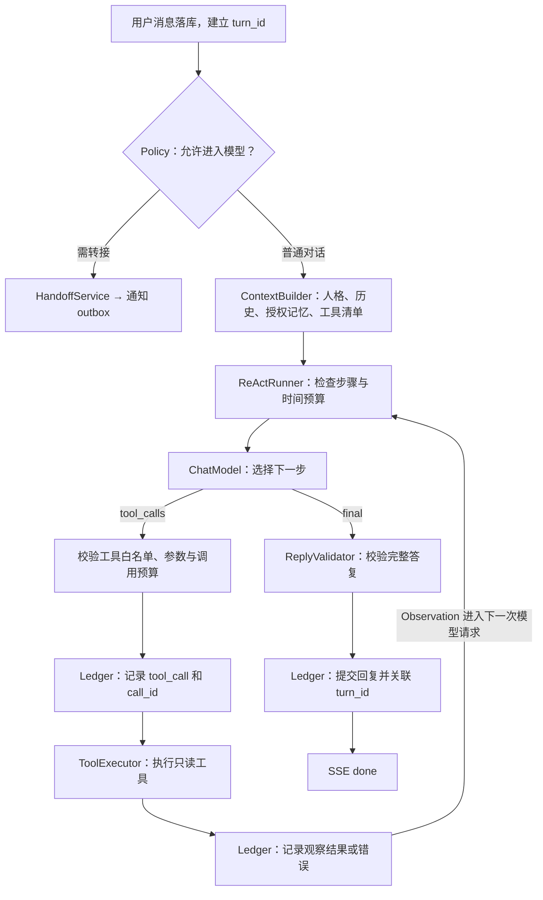

# stand-in · Agent 架构实施计划

> 实施计划｜2026-11-07。基于现有 `SPEC.md`、`ARCH.md` 与 `D:\akashic-agent` 的实际代码。此文档用于确定施工顺序；涉及产品语义的修改，实施前同步更新 `SPEC.md`，实施后的结构同步更新 `ARCH.md`。

## 1. 目标与边界

做一个只供她使用、明确告知 AI 身份和记录范围的私人陪伴 agent。它能可靠地回复、记住被允许记住的事、在合适的时机主动联系，并在需要本人时给出真实的转接状态。

保持单进程、单用户、FastAPI + React + SQLite + 文件化人格资产。暂不引入动态插件系统、多 agent 或向量数据库。实现一个有界的单 agent ReAct 循环；模型只能调用本轮授权的工具，首批工具只读。是否发送消息、修改状态、通知本人和删除数据由确定性服务决定。

## 2. 从 Akashic 借什么

| Akashic 的做法 | stand-in 的小型实现 |
|---|---|
| Ledger 是消息唯一 owner，历史是事实，窗口只是投影 | SQLite 保存用户消息、回复、回合状态和关联 ID；提示词只读取投影，不改历史 |
| Reply/ReAct/Delivery 分别拥有执行与发送 | `TurnService` 接纳回合；`ReActRunner` 在有界循环中生成、调用工具并记录观察；`DeliveryService` 只投递已提交消息 |
| 外部效果有明确回执和失败语义 | 通知本人、Web Push 记录 `pending/accepted/failed/unknown`，不能用“已发送”冒充“已看到” |
| Context/Memory 是受控材料 | 记忆按可见性、来源、时效和授权投影；私密原文及自由文本 hint 不传给模型 |
| 主动流程有独立接纳条件 | 调度器只提出候选；纯函数闸门决定是否发、为什么不发；错过窗口不补发 |

不复制 Akashic 的插件安装、热换代、Fiber、通用 ReAct 框架和跨渠道宿主。只实现当前聊天任务所需的一个小型 ReActRunner。

## 3. 目标结构

```text
web/ ── HTTP/SSE ── api/
                    │
                    ├── TurnService ── Policy ── ContextBuilder
                    │       │                    │
                    │       └── ReActRunner ◄────┘
                    │             ├── ChatModel（模型提出 final 或 tool_calls）
                    │             ├── ToolRegistry（本轮白名单）
                    │             ├── ToolExecutor（调用与回执）
                    │             └── ReplyValidator（最终答复）
                    │                      │
                    │                    Ledger
                    │
                    ├── ProactiveService ── Gate ── Outbox ── DeliveryService
                    │
                    ├── HandoffService ── OwnerInbox ── Notifier
                    │
                    └── DataControlService ── export / delete / retention

files/: persona、经批准的记忆、私密情境策略
sqlite/: 消息、回合、状态、outbox、投递回执、审计记录
llm/: 可替换的模型适配器
```

`services/` 继续只依赖 `ports.py`。不把调度、持久化或安全决策放进模型适配器。`ReActRunner` 是服务层的小型状态机；`ChatModel` 适配器只负责模型协议。当前不引入 PydanticAI 或第二套 agent 框架。

### 3.1 一轮 ReAct 的真实链路



循环有模型请求次数、工具调用次数、耗时和 token 预算；达到上限时生成明确的保守答复或失败状态，不能无限自问自答。重启后从已提交的消息与工具回执恢复；已完成的工具调用不因模型重试而再次执行。最初只有读取 `chat` 可见记忆的工具，私密原文、任意文件、Shell、通知和发送均不在工具菜单里。主动消息默认不开放工具调用，确有需要时单独批准只读工具。

模型可能在同一输出中给出文字和工具调用。首版先收完整个模型步骤，判定是 `final` 还是 `tool_calls`，只向前端预览最终答复；SSE 仍用于分条展示和完成回执。后续若要恢复真正的 token 实时预览，须先证明不会把工具步骤或未经校验的内容误当最终答复展示。

## 4. 决策先定

1. **身份始终诚实。** 删除 `disclosure=never`。她已经知情，身份问题走普通对话；提示词要求如实回答，首页仍说明记录范围。
2. **每轮有稳定身份。** `client_msg_id` 唯一指向一个 `turn_id`；机器人消息显式指向所属回合，不用“之后第一条回复”推断关联。
3. **预览不等于完成。** 当前 SSE 的 `delta` 播放已提交的回复；客户端收到 `done` 才确认交付完成。连接断开时按 `client_msg_id` 查询回合状态，不把 EOF 当成功。
4. **事实先于外部动作。** 主动消息和本人通知先在同一事务内留下意图与幂等键，再由独立发送器执行；回执标明发送服务接受、失败或结果未知。
5. **私密记忆只产出受控策略。** 私密条目可供规则层判断，但模型只见有限枚举的情境标签与固定文案；任意 `hint` 不进提示词。
6. **不自动把对话变成长期记忆。** 可从对话提出候选，须经明确确认后才进入可检索记忆；保留来源、更新时间、过期和删除路径。
7. **ReAct 有界且可追溯。** 每个模型步骤和工具调用属于同一 `turn_id`；工具先校验授权，再记录调用与回执。模型不能借工具调用绕过转接、发送或数据控制服务。

## 5. 施工批次

### 当前进度（2026-11-07）

| 批次 | 状态 | 仍需完成 |
|---|---|---|
| A 信任边界 | 大部分完成 | 旧历史中可能已有的敏感回显需排查；通知的跨请求幂等和独立发送器留待 D |
| B 回合账本 | 已完成并通过回归测试 | 生产环境仍需单 worker；跨进程滚动重启的在途回合接管留待部署演练 |
| C ReAct | 未开始 | 服务拆分、结构化工具调用、只读记忆工具、预算和步骤回执 |
| D 主动消息 | 仅有仓储与配置骨架 | 调度闸门、outbox、投递回执和重启去重 |
| E 数据控制 | 仅有本人登录 | 本人后台、她的导出/删除/记忆纠错及保留期 |
| F 质量上线 | 仅有基础测试与部署文件 | 场景回归、真人盲测、部署与备份恢复演练 |

代码中已有 SQLite 的主动消息仓储和相关配置，但尚无 `ProactiveService` 或调度器；这不算 D 已交付。聊天两种入口已共用回合账本，但当前仍是 `ReplyService` 一次调用模型，没有 ReAct 循环。本地 `persona/` 缺少 `fewshot.jsonl`，并仍有未填占位。

### A. 收紧现有信任边界

> 2026-11-07 已移除身份问题的专门拦截，保留普通对话中的诚实约束；受控私密标签、通知状态回执和相关回归测试已落实。当前通知意图记录在 `owner_inbox`；跨请求幂等与独立 outbox 发送器仍依赖 D 投递批次。

- 删除身份否认模式及身份词表；身份问题按普通对话生成，保留如实回答的提示词约束。
- 危机和叫本人统一走 `HandoffService`：持久记录通知请求，发送结果可查；未确认送达时回复不能声称本人已收到。
- 扩充安全用例集，覆盖口语、否定、引用和绕写；无法可靠判断时给出直接联系真人的入口，不让生成模型单独决定是否转接。
- 私密 `situation/hint` 改为受控标签及固定行为规则；加入标签、hint、历史回显和日志的泄漏检查。

**验收：** 身份问题不走固定回复，模型提示词要求如实回答；危机与叫本人在通知失败时返回真实状态；私密原文和自由文本元数据不进入模型请求。

### B. 建立回合账本

- 添加 SQLite 迁移：`turns` 表保存 `turn_id/client_msg_id/status/input_message_id/output_message_id/error_code/timestamps`；`messages` 增加 `turn_id` 和明确的回复关联。迁移只追加结构，保留既有消息内容与顺序。
- 用 `TurnRepo` 在同一事务写入回合和输入，状态从 `generating` 转为 `committed/failed`；当前没有排队阶段，因此不持久化 `pending`。同一 `client_msg_id` 并发请求只执行一次。旧消息按原顺序可读，不伪造过去没有记录的关联。
- 统一 `/api/chat` 与 `/api/chat/stream` 的服务入口；流式协议增加 `turn_id`，仅在提交后发 `done`；提供回合状态查询与重连恢复。
- 前端要求收到 `done` 才算成功，按稳定消息 ID 合并预览与已提交历史；断线后查询状态并复用原请求 ID。

**验收：** 并发重试不产生双回复、不会串到其他回合；断流后刷新能区分“已完成、失败、仍在处理”；数据库里已有记录保持原样。

**实施结果：** `003_turns.sql` 建立回合表与消息关联；两个聊天接口共用 `ReplyService.reply()`。回复先提交，再以 SSE 分条播放；状态接口可按 `turn_id` 或 `client_msg_id` 查询。前端持久保存待处理的客户端消息 ID，断流、刷新后查询状态。启动时将未完成的 `generating` 回合标记为 `interrupted`。并发重试、错误、断流、迁移和重启用例已覆盖。

### C. 做有界的 ReAct 回复生成

- 把 `ReplyService` 拆成 `TurnService`、`ContextBuilder`、`ReActRunner`、`ToolRegistry/ToolExecutor` 与 `ReplyValidator`。扩展 `ChatModel` 协议，使一次模型请求返回 `final` 或结构化 `tool_calls`；保留现有 OpenAI 兼容适配器。
- 增加回合步骤和工具回执的持久记录，给工具调用稳定 `call_id`；先接入一个只读的 `recall_memory`，只返回 `chat` 可见、未过期且有来源的记忆。
- 每次模型调用前核对回合是否仍有效、工具是否仍获授权、预算是否用尽；工具失败作为明确观察交回模型，不能伪造成功。模型重试不得重复有副作用的动作。
- 检索结果携带来源和时效；共同经历、日期、承诺只在有依据时进入候选回复；输出后校验长度、禁语、身份与未经证实的承诺。
- 将人格卡占位补齐，采集 40–60 条经筛选的少样本示例；测试集与示例集分开。

**验收：** 可复现 `模型 → 召回工具 → 观察 → 模型 → 最终答复`；无权限或超预算调用明确拒绝；重启恢复不重复已提交工具回执；同一输入可追溯到人格版本、工具观察与输出校验结果；40 条保留样本中记录捏造事实、越界记忆和不像本人的具体原因。

### D. 主动消息与投递

- 实现 `ProactiveService`：调度只产生候选，11 条闸门按 `SPEC.md` 顺序判断，并记录原因码。
- 引入 `outbox` 和投递回执；`(本地日期, task_id)` 幂等。内容生成、审核、落库、发送分步记录；崩溃后不盲目补发。
- 先只启用 `lunch`，在网页打开时能看到已提交消息；若要在网页关闭时提醒她，再加经她明确同意的 Web Push。服务接受推送不等于设备已读。

**验收：** 静默、未回复不追、每日上限、时间窗、重启去重逐项复现；断网和重启后不重复打扰；后台能解释每次跳过或发送。

### E. 她的数据控制与本人后台

- `/me` 使用独立身份，只读消息、查看通知及投递状态、编辑经批准的记忆与主动任务。
- 她的设置页增加导出、删除和记忆纠错。删除流程覆盖数据库、记忆文件、派生数据和备份；定义可操作的保留期与备份淘汰方式。
- 对“本人可看记录”和模型服务会接收哪些内容给出清楚说明；她可暂停主动联系。

**验收：** 导出可重新阅读；删除后 API、重启恢复和备份恢复路径都不再暴露被删除内容；本人后台与她的访问权限分离。

### F. 质量与上线

- 建立场景回归集：披露、危机、记忆冲突、误召回、ReAct 多步与预算耗尽、工具失败与恢复、断流、重复请求、主动打扰、通知失败。
- 在独立测试数据上做真人盲测和一周试用；指标同时记录“像不像”“事实是否准确”“是否打扰”“能否掌控数据”。
- 做真实部署演练：HTTPS、备份与恢复、密钥轮换、日志脱敏、健康检查及通知失败告警。

**验收：** 能从空环境部署并恢复到已知状态；发生故障时能从回合、outbox 和投递回执定位真实结果。

## 6. 实施顺序与依赖

`A → B → C` 是交付前的主链；`D` 依赖 B 的稳定回合状态，并在 D 中引入 outbox；`E` 的数据导出与删除依赖 B 的明确数据归属；`F` 随每批积累场景，最后做端到端演练。每批只改变一个主要状态 owner 或外部效果，先验证旧数据与旧行为，再打开新入口。

下一个可执行批次是 **C 的有界 ReAct 回复生成**。D 的通知发送器和主动消息依赖稳定的回合与 outbox 语义。

## 7. 开工前需要的人类素材

- 完成人格卡剩余占位；提供经你筛选的真实回复示例，去掉第三人隐私。
- 确认她愿意使用 AI、知道你能看哪些记录，并决定主动提醒是否默认关闭直到她开启。
- 确定本人通知的可靠渠道和故障时的替代联系方式。

这些是产品输入，不应由模型从聊天里猜测或自行补全。
